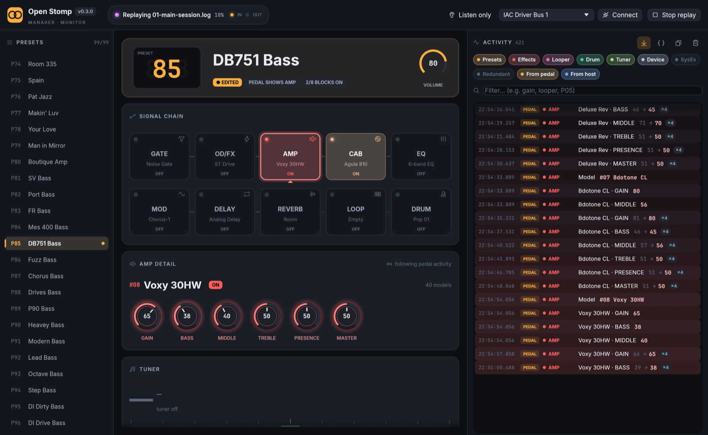

# Open Stomp Manager

An open editor for the SORAN Dual Stomp Lite ·
Version **0.8.1** · Linux · macOS · Windows · [documentation](https://jackmechem.github.io/open-stomp-lib/) · [changelog](CHANGELOG.md)

Open Stomp Manager is a cross-platform desktop editor and live monitor for the **SORAN Dual Stomp Lite** guitar
multi-effects pedal. The vendor's editor, *Stomp Manager*, only runs on macOS and Windows. This one also runs on
**Linux**.



It is built on **[open-stomp](https://github.com/JackMechem/open-stomp-lib)**, the library that implements the
pedal's reverse-engineered USB-MIDI protocol. The library's repository also holds the protocol and
reverse-engineering documentation.

> Probably also works with the Dual Stomp and Tiny Stomp (same firmware family, same vendor app). Only the Dual Stomp
> Lite on firmware **V1.1.1** has been tested.

## Features

* **Connects automatically** when the pedal is plugged in (no driver on any OS) and reads all 99 presets, the live
  sound, settings and user NAM/IR slot names, like the official app.
* **Live view** of the active preset, signal chain, every block's model and parameters, tuner, looper and drum
  machine. Changes made on the pedal show up instantly and glow briefly.
* **Editing:** select presets, pick models, switch blocks on/off, turn knobs (drag, scroll wheel, Shift for fine
  steps), set preset volume, and run the looper and drum machine. Edits change the live sound until you save.
* **Save** and **Save as…** (rename and/or store in another slot) with the official app's exact message sequence.
* **System settings:** input trim, global EQ, wireless, USB loopback.
* **Activity log** of everything that happens on the pedal in plain English, with knob sweeps merged into one row,
  category filters, search and raw bytes.
* **Import NAM models and cab IRs** into the user slots, with open-stomp's optimised conversions (closer to the
  real model and cab on the pedal than the official app's; [results](https://jackmechem.github.io/open-stomp-lib/analysis/results.html)) or the
  official app's algorithm.
* **Listen-only mode** that never sends anything, and **capture replay** to try the app without a pedal.

| Area | Status |
|---|---|
| Monitor: presets, chain, params, tuner, looper, drum, settings, user slots | ✅ |
| Live edits (presets, models, on/off, knobs, volume, looper, drum) | ✅ verified on hardware |
| Preset save / rename, settings writes | ✅ byte-identical to the official app, not yet run on hardware |
| NAM model and IR import | ✅ optimised or official conversion, uploaded to the user slots (NAM since 0.6, IR since 0.7) |

## Install

Download a package from [Releases](https://github.com/JackMechem/open-stomp-manager/releases):

| Platform | Package |
|---|---|
| Linux (x86_64) | `…-linux-x86_64.tar.gz`: binary, `.desktop` file, icon |
| macOS 11+ (Apple Silicon + Intel) | `…-macos-universal.zip`: `Open Stomp Manager.app` |
| Windows 10+ (x86_64) | `…-windows-x86_64.zip`: `open-stomp-manager.exe` |

* **macOS:** the app is ad-hoc signed, not notarized. The first time, right-click it and choose *Open* (or run
  `xattr -dr com.apple.quarantine "Open Stomp Manager.app"`).
* **Windows:** a MIDI port can be open in only one program at a time, so quit the official Stomp Manager first.
* **Nix:** `nix run github:JackMechem/open-stomp-manager/stable` (the newest release), `…/unstable` (the newest
  release or pre-release) or `github:JackMechem/open-stomp-manager` (`main`). As a flake input,
  `url = "github:JackMechem/open-stomp-manager/stable";` and `nix flake update` brings in each new release.

Then plug the pedal in. See the **[user guide](docs/user-guide.md)** for everything in the window.

## Build from source

The app uses the library as a sibling checkout:

```sh
git clone https://github.com/JackMechem/open-stomp-lib
git clone https://github.com/JackMechem/open-stomp-manager
cd open-stomp-manager
cargo run -p open-stomp-manager                     # Rust ≥ 1.95; on Linux also libasound2-dev / alsa-lib-devel
cargo run -p open-stomp-manager -- --replay captures/logs/01-main-session.log --speed 8   # no pedal needed
nix run                                             # or with Nix (nix develop for a dev shell)
```

[building.md](docs/building.md) covers platforms, packaging, CI, versioning and releases.

## Documentation

**All of it is on the [documentation site](https://jackmechem.github.io/open-stomp-lib/)**, together with the library's guides, the protocol docs
and the NAM / IR analysis.

| | |
|---|---|
| [User guide](docs/user-guide.md) | Connecting, presets, chain, knobs, saving, looper/drum/tuner, settings, activity log, replay, troubleshooting |
| [Building](docs/building.md) | Source layout, Nix and cargo builds, platforms, packaging, CI, releasing |
| [Architecture](docs/architecture.md) | How the app is built on the library: data flow, editing, the activity log, adding features |

**Protocol and reverse engineering** are documented in the library's repository,
[open-stomp-lib](https://github.com/JackMechem/open-stomp-lib):

| | |
|---|---|
| [01 Overview](https://github.com/JackMechem/open-stomp-lib/blob/main/docs/01-overview.md) | Hardware, USB interfaces, protocol summary, the official app |
| [02 MIDI CC reference](https://github.com/JackMechem/open-stomp-lib/blob/main/docs/02-midi-cc-reference.md) | Every CC/PC: all models and params, looper, drum, tuner |
| [03 SysEx protocol](https://github.com/JackMechem/open-stomp-lib/blob/main/docs/03-sysex-protocol.md) | Framing, command table, handshake, encodings, captured write sequences |
| [04 Data structures](https://github.com/JackMechem/open-stomp-lib/blob/main/docs/04-data-structures.md) | Preset, settings, IR/NAM slot, drum/loop/tuner records |
| [05 NAM & IR uploads](https://github.com/JackMechem/open-stomp-lib/blob/main/docs/05-uploads-nam-ir.md) | Upload transport and what's known about the conversion |
| [06 Rust/Linux guide](https://github.com/JackMechem/open-stomp-lib/blob/main/docs/06-rust-linux-guide.md) | Talking to the pedal from Rust and a Linux shell |
| [07 Capture methodology](https://github.com/JackMechem/open-stomp-lib/blob/main/docs/07-capture-methodology.md) | How the official app was sniffed, and how to make new captures with `tools/` here |
| [08 Static analysis](https://github.com/JackMechem/open-stomp-lib/blob/main/docs/08-static-analysis.md) | App binary (Flutter/Dart AOT), native libs, firmware notes (`analysis/` here) |
| [09 Open questions](https://github.com/JackMechem/open-stomp-lib/blob/main/docs/09-open-questions.md) | What's left and how to find out |
| [10 Library guide](https://github.com/JackMechem/open-stomp-lib/blob/main/docs/10-library-guide.md) | Using the `open-stomp` crate to build your own tools |

## Repository layout

```
crates/open-stomp-manager/ the egui desktop app (built on ../open-stomp-lib)
docs/                 user guide, building, architecture
packaging/            icons (+ generator), Linux .desktop, macOS bundle script, version check
.github/workflows/    CI (Linux/macOS/Windows) and tag-triggered release builds
flake.nix             Nix package + dev shell
CHANGELOG.md          release history
project.md            app notes and roadmap (protocol notes: the library's project.md)
```

The reverse-engineering workbench (documented in the library's docs 07 and 08) also lives here:

```
tools/sniffer/        macOS CoreMIDI interposer + helpers used to capture the official app
tools/decode/         Python decoders: live.py (human-readable live decode), analyze.py, unpack.py,
                      preset_layout.py, nam_extract.py; ocr.swift (screenshot OCR)
captures/logs/        raw capture logs (01-main-session.log = 2 h annotated session); also the
                      library's test vectors
captures/LAB_NOTES.md running notebook from the capture session (superseded by the library's docs)
analysis/             static-analysis dumps and scripts (large/proprietary artefacts are git-ignored)
```

## Legal

This is an independent interoperability project. It is not affiliated with or endorsed by SORAN, NUX/Cherub or
JiYou. Product names are trademarks of their owners. The repo contains **no vendor binaries or firmware**: only our
own code and tools, and captures of traffic between the author's own pedal and app. Third-party NAM/IR files are not
included. Use at your own risk: writing bad data to a pedal could corrupt presets. Back them up first.

## License

TBD by the repository owner. MIT/Apache-2.0 is suggested for the code and CC-BY-4.0 for the docs.
